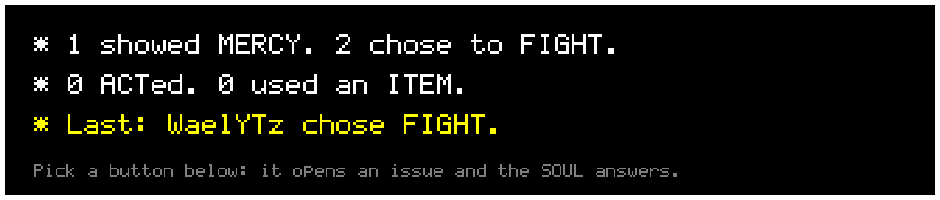
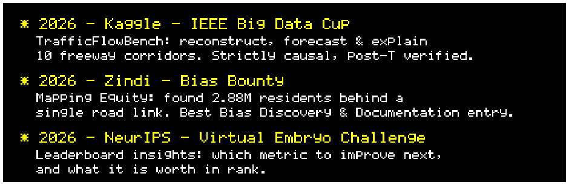
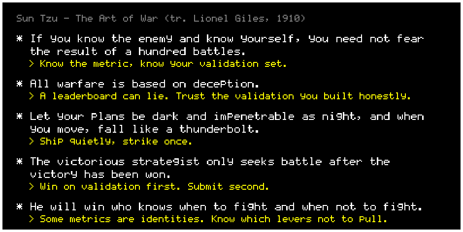
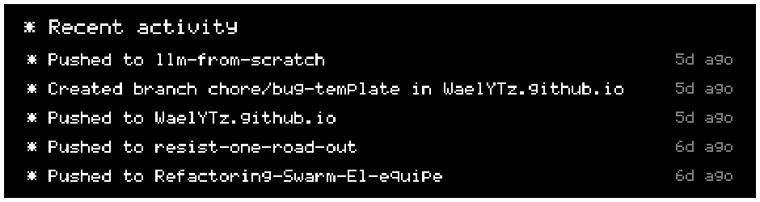
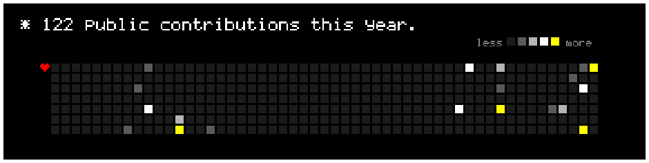

<!-- ═══════════════════════════════ HEADER ═══════════════════════════════ -->
<p align="center"></p>

<p align="center">
  
</p>

<p align="center">
  <a href="https://waelytz.github.io"></a>
  <a href="https://www.kaggle.com/waelyt"></a>
  
  
</p>

<p align="center">
  <b>Hi, I'm Wael</b>: ML engineer and AI-agent builder. I build forecasting models and multi-agent LLM systems, and compete on Kaggle and Zindi.<br/>
  Open to collaborations on machine learning, AI agents and data competitions.<br/><br/>
  ♥ <a href="https://waelytz.github.io"><b>Play my portfolio</b></a>: an explorable pixel-art underground where every room is a project. No time? <a href="https://waelytz.github.io/resume/">Read the résumé</a>.
</p>

<!-- ═══════════════════════════════ ENCOUNTER ═══════════════════════════════ -->
<p align="center"></p>

<p align="center"></p>

<p align="center">
  <a href="https://github.com/WaelYTz/WaelYTz/issues/new?title=encounter%7Cfight&body=%2A+Press+%22Create%22+and+the+SOUL+will+answer+in+a+few+seconds."></a>
  <a href="https://github.com/WaelYTz/WaelYTz/issues/new?title=encounter%7Cact&body=%2A+Press+%22Create%22+and+the+SOUL+will+answer+in+a+few+seconds."></a>
  <a href="https://github.com/WaelYTz/WaelYTz/issues/new?title=encounter%7Citem&body=%2A+Press+%22Create%22+and+the+SOUL+will+answer+in+a+few+seconds."></a>
  <a href="https://github.com/WaelYTz/WaelYTz/issues/new?title=encounter%7Cmercy&body=%2A+Press+%22Create%22+and+the+SOUL+will+answer+in+a+few+seconds."></a>
</p>

<!-- ═══════════════════════════════ WHOAMI ═══════════════════════════════ -->
<p align="center"></p>

```console
wael@github:~$ whoami
  ML engineer · AI-agent builder · competition data scientist

wael@github:~$ cat ./creed.txt
  "Technoblade never dies."
  "All warfare is based on deception."  - Sun Tzu

wael@github:~$ ls ./arsenal
  python  pytorch  xgboost  lightgbm  catboost  scikit-learn  langgraph  langchain  pandas  numpy  typescript

wael@github:~$ ./now --status
  [■■■■■■■■■□] shipping causal forecasting models & multi-agent systems
```

<!-- ═══════════════════════════════ LEADERBOARD LOG ═══════════════════════════════ -->

<p align="center"></p>

<p align="center"></p>

<p align="center"><sub>code: <a href="https://github.com/WaelYTz/trafficflowbench-2026">trafficflowbench-2026</a> · <a href="https://github.com/WaelYTz/resist-one-road-out">resist-one-road-out</a> · <a href="https://github.com/WaelYTz/vec-leaderboard-insights">vec-leaderboard-insights</a></sub></p>

<!-- ═══════════════════════════════ ART OF WAR ═══════════════════════════════ -->

<p align="center"></p>

<p align="center"></p>

<!-- ═══════════════════════════════ TECHNOBLADE ═══════════════════════════════ -->

<p align="center"></p>
<p align="center"></p>

<p align="center">
  <i>"Blood for the Blood God."</i><br/>
  <i>"Not even close, baby. Technoblade never dies!"</i>
</p>

```console
wael@github:~$ ./grind --mode technoblade
  [potato farm]    ████████████████  harvested
  [skill issue]    ░░░░░░░░░░░░░░░░  not found
  [give up]        command not found
```

<!-- ═══════════════════════════════ UNDERTALE ═══════════════════════════════ -->

<p align="center"></p>

<p align="center">
  
</p>

```console
wael@github:~$ save --slot 0
  * Despite everything, it's still you.
  * The progress of 3 competitions has been saved.
  * HP fully restored.
```

<!-- ═══════════════════════════════ PROJECTS ═══════════════════════════════ -->

<p align="center"></p>

<p align="center">
  <a href="https://github.com/WaelYTz/trafficflowbench-2026"></a>
  <a href="https://github.com/WaelYTz/Refactoring-Swarm-El-equipe"></a>
  <a href="https://github.com/WaelYTz/resist-one-road-out"></a>
  <a href="https://github.com/WaelYTz/vec-leaderboard-insights"></a>
  <a href="https://github.com/WaelYTz/ML_AlgorithmsFromScratch"></a>
</p>

<p align="center"></p>

<p align="center"></p>

<!-- ═══════════════════════════════ STACK ═══════════════════════════════ -->

<p align="center"></p>

<p align="center">
  
</p>
<p align="center">
  
  
  
  
  
  
  
  
  
</p>

<!-- ═══════════════════════════════ STATS ═══════════════════════════════ -->

<p align="center"></p>

<p align="center"></p>
<p align="center"></p>

<p align="center"></p>

<p align="center"></p>

<!-- ═══════════════════════════════ JOURNEY ═══════════════════════════════ -->

<p align="center">
  
</p>

<!-- ═══════════════════════════════ FOOTER ═══════════════════════════════ -->
<p align="center"></p>
