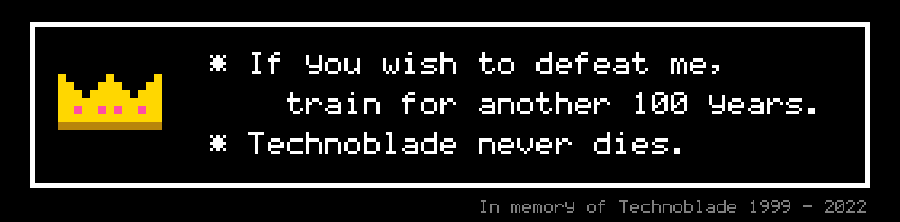
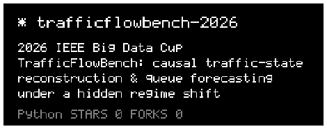
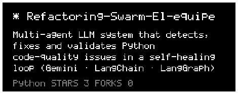
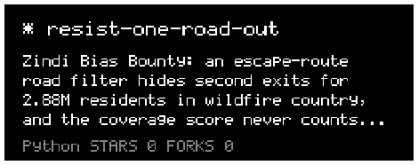
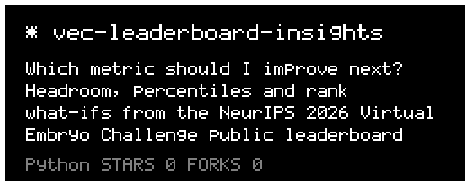
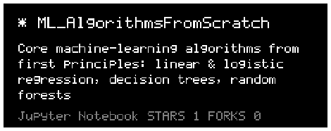
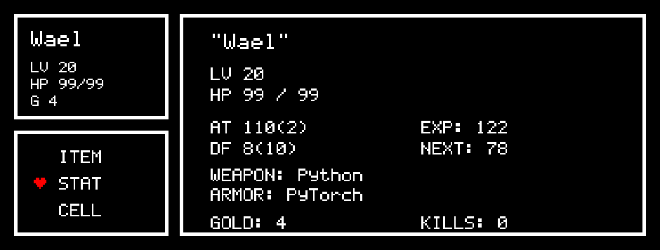
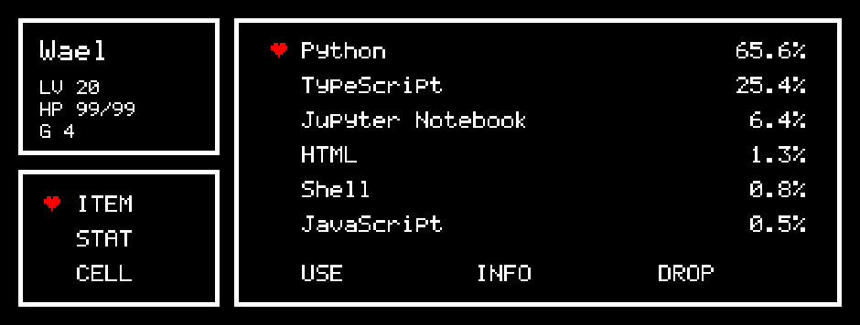
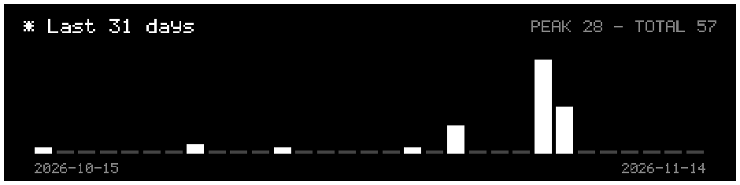

<!-- ═══════════════════════════════ HEADER ═══════════════════════════════ -->
<p align="center"></p>

<p align="center">
  
</p>

<p align="center">
  <a href="https://www.kaggle.com/waelyt"></a>
  
  
</p>

<!-- ═══════════════════════════════ WHOAMI ═══════════════════════════════ -->
<p align="center"></p>

```console
wael@github:~$ whoami
  ML engineer · AI-agent builder · competition data scientist

wael@github:~$ cat ./creed.txt
  "Technoblade never dies."
  "All warfare is based on deception."  - Sun Tzu

wael@github:~$ ls ./arsenal
  python  pytorch  xgboost  lightgbm  catboost  scikit-learn  langgraph  langchain  pandas  numpy  typescript

wael@github:~$ ./now --status
  [■■■■■■■■■□] shipping causal forecasting models & multi-agent systems
```

<!-- ═══════════════════════════════ LEADERBOARD LOG ═══════════════════════════════ -->

<p align="center"></p>

<table>
  <tr>
    <th align="left">year</th><th align="left">arena</th><th align="left">challenge</th><th align="left">run</th><th align="left">code</th>
  </tr>
  <tr>
    <td><code>2026</code></td>
    <td>🟦 Kaggle · IEEE Big Data Cup</td>
    <td><b>TrafficFlowBench</b>: reconstruct, forecast & explain 10 freeway corridors</td>
    <td>strictly causal pipeline, post-T verified · full write-up in the repo</td>
    <td><a href="https://github.com/WaelYTz/trafficflowbench-2026">trafficflowbench-2026</a></td>
  </tr>
  <tr>
    <td><code>2026</code></td>
    <td>🟧 Zindi · Bias Bounty</td>
    <td><b>Mapping Equity</b>: audit the bias in a wildfire escape-route map</td>
    <td>found <b>2.88 M residents</b> behind a single road link; entry for Best Bias Discovery & Best Documentation</td>
    <td><a href="https://github.com/WaelYTz/resist-one-road-out">resist-one-road-out</a></td>
  </tr>
  <tr>
    <td><code>2026</code></td>
    <td>🧬 NeurIPS · Virtual Embryo Challenge</td>
    <td><b>Leaderboard insights</b>: which metric to improve next, and what it is worth in rank</td>
    <td>dependency-free tool + daily anonymised snapshots via GitHub Actions</td>
    <td><a href="https://github.com/WaelYTz/vec-leaderboard-insights">vec-leaderboard-insights</a></td>
  </tr>
</table>

<!-- ═══════════════════════════════ ART OF WAR ═══════════════════════════════ -->

<p align="center"></p>

<table>
  <tr><th align="left">Sun Tzu <sub>(tr. Lionel Giles, 1910)</sub></th><th align="left">on the leaderboard</th></tr>
  <tr>
    <td><i>"If you know the enemy and know yourself, you need not fear the result of a hundred battles."</i></td>
    <td>Know the metric, know your validation set. Read the scorer before you write the model.</td>
  </tr>
  <tr>
    <td><i>"All warfare is based on deception."</i></td>
    <td>A leaderboard can lie. Trust the validation set you built honestly.</td>
  </tr>
  <tr>
    <td><i>"Let your plans be dark and impenetrable as night, and when you move, fall like a thunderbolt."</i></td>
    <td>Ship quietly, strike once. Let the work speak on release day.</td>
  </tr>
  <tr>
    <td><i>"The victorious strategist only seeks battle after the victory has been won."</i></td>
    <td>Win on validation first. Submit second.</td>
  </tr>
  <tr>
    <td><i>"He will win who knows when to fight and when not to fight."</i></td>
    <td>Some metrics are identities. Know which levers not to pull.</td>
  </tr>
</table>

<!-- ═══════════════════════════════ TECHNOBLADE ═══════════════════════════════ -->

<p align="center"></p>
<p align="center"></p>

<p align="center">
  <i>"Blood for the Blood God."</i><br/>
  <i>"Not even close, baby. Technoblade never dies!"</i>
</p>

```console
wael@github:~$ ./grind --mode technoblade
  [potato farm]    ████████████████  harvested
  [skill issue]    ░░░░░░░░░░░░░░░░  not found
  [give up]        command not found
```

<!-- ═══════════════════════════════ UNDERTALE ═══════════════════════════════ -->

<p align="center"></p>

<p align="center">
  
</p>

```console
wael@github:~$ save --slot 0
  * Despite everything, it's still you.
  * The progress of 3 competitions has been saved.
  * HP fully restored.
```

<!-- ═══════════════════════════════ PROJECTS ═══════════════════════════════ -->

<p align="center"></p>

<p align="center">
  <a href="https://github.com/WaelYTz/trafficflowbench-2026"></a>
  <a href="https://github.com/WaelYTz/Refactoring-Swarm-El-equipe"></a>
  <a href="https://github.com/WaelYTz/resist-one-road-out"></a>
  <a href="https://github.com/WaelYTz/vec-leaderboard-insights"></a>
  <a href="https://github.com/WaelYTz/ML_AlgorithmsFromScratch"></a>
</p>

| | project | what it does |
|---|---|---|
| 🚦 | [**trafficflowbench-2026**](https://github.com/WaelYTz/trafficflowbench-2026) | XGBoost + 14-net convolutional imputer for traffic state, space-time CNN queue forecasting, and a proof that the physics metric is an identity |
| 🤖 | [**Refactoring Swarm**](https://github.com/WaelYTz/Refactoring-Swarm-El-equipe) | Multi-agent LLM system (Gemini · LangChain · LangGraph) that detects, fixes and validates Python code-quality issues in a self-healing loop |
| 🔥 | [**One road out**](https://github.com/WaelYTz/resist-one-road-out) | Shows how an "escape-route" road filter hides second exits for wildfire-exposed communities, and why the coverage score misses it |
| 🧬 | [**VEC Leaderboard Insights**](https://github.com/WaelYTz/vec-leaderboard-insights) | Headroom, percentile and rank what-ifs from a NeurIPS challenge leaderboard |
| 🧮 | [**ML from scratch**](https://github.com/WaelYTz/ML_AlgorithmsFromScratch) | Linear and logistic regression, decision trees and random forests, written from first principles |

<!-- ═══════════════════════════════ STACK ═══════════════════════════════ -->

<p align="center"></p>

<p align="center">
  
</p>
<p align="center">
  
  
  
  
  
  
  
  
  
</p>

<!-- ═══════════════════════════════ STATS ═══════════════════════════════ -->

<p align="center"></p>

<p align="center"></p>
<p align="center"></p>

<p align="center"></p>

<p align="center"></p>

<!-- ═══════════════════════════════ SNAKE ═══════════════════════════════ -->

<p align="center">
  
</p>

<!-- ═══════════════════════════════ FOOTER ═══════════════════════════════ -->
<p align="center"></p>
